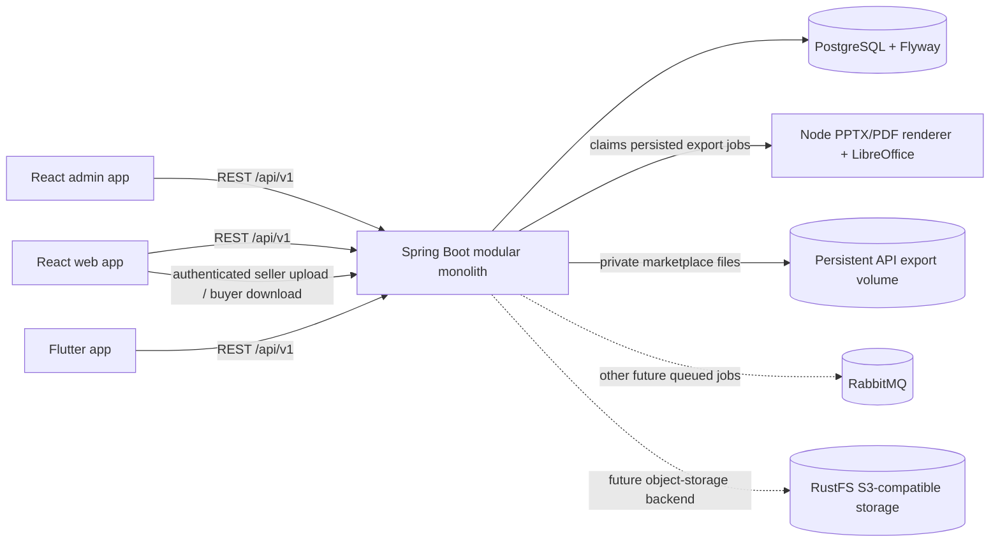
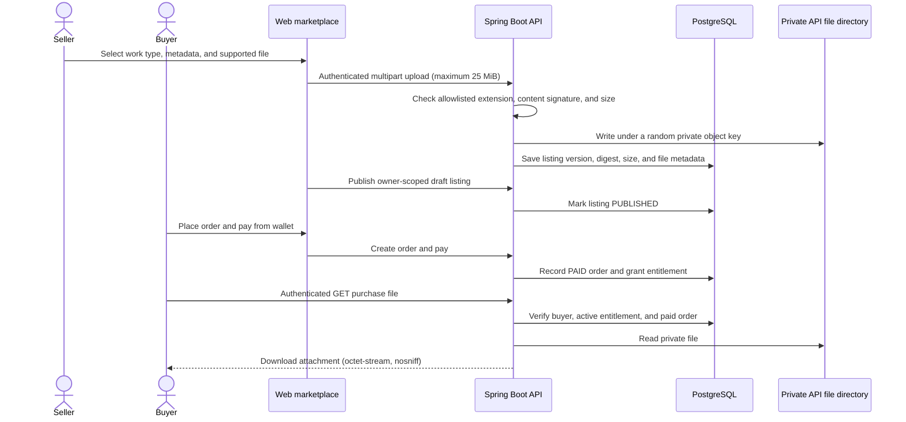

# Architecture

## Components

The backend is one deployable Spring Boot modular monolith. Packages are grouped by business capability; PostgreSQL is the source of truth for metadata and immutable listing versions. The canonical, versioned deck JSON is shared by the presentation editor and renderer. Written/interactive learning artifacts use a distinct typed JSON model with immutable PostgreSQL versions and are never encoded as decks. The renderer is a separate Node package: `pptxgenjs` writes editable PowerPoint and LibreOffice produces PDF, while artifact rendering writes editable DOCX and printable PDF. Marketplace uploads use an API-private directory under the persistent export volume; RustFS is not yet integrated with marketplace files. Web and Flutter provide presentation and artifact libraries/editors; the admin client provides role-protected user management.

## Request and job flows

Clients call the versioned `/api/v1` API. Authentication, profile, and owner-scoped presentation routes are implemented; registration, login, refresh, verification, and password-action endpoints pass through a per-instance auth rate limiter. Production Caddy sets `X-Forwarded-For` to the connected client address, and Spring's forwarded-header strategy makes the API rate limiter use that address rather than the shared proxy address. The API is private behind Caddy; a multi-instance deployment needs a distributed rate limiter. Actuator exposes liveness/readiness health. Springdoc serves the OpenAPI UI in development and is disabled by production Compose. Flyway applies SQL migrations when the API starts against PostgreSQL.

Export flow: the authenticated API validates presentation ownership, pins the requested immutable version, and persists an export job in PostgreSQL. The scheduled worker claims queued jobs with `FOR UPDATE SKIP LOCKED`, sends canonical JSON to the private renderer service, and stores the generated artifact on the configured persistent export volume. Clients poll the owner-scoped API and download through an authenticated route. Stale running jobs are requeued after the configured timeout.

Learning-artifact saves are owner-scoped and create immutable versions. Artifact export endpoints pin either the current or requested version and invoke the private renderer synchronously; unlike presentation exports, artifact exports do not yet create export-job records. Quiz answers and crossword entries are validated server-side; clients provide interactive play controls while retaining the answer key in the editable model.

AI generation flow: an authenticated API request persists a bounded owner-scoped job in PostgreSQL. The API-process worker claims queued jobs and calls a server-configured OpenAI-compatible provider with a timeout. It validates and normalizes the returned deck against the canonical schema and output limits before persisting success; provider errors or invalid output fail explicitly. Clients poll the job and save a successful result as a presentation. RabbitMQ is not used by this current workflow.

Artifact AI drafting uses a separate type-specific server prompt and validates the returned structure before exposing it as an editable draft. This first artifact flow calls the configured provider synchronously and does not persist draft-job status; persisted artifact content and every later edit are versioned independently.

## Marketplace file flow

The private directory shares the persistent `exports_data` volume in local and production Compose. The API does not expose object keys or public download URLs. Uploaded files currently lack malware scanning/quarantine; extension/signature validation is not a substitute for scanning. RustFS/S3 remains a possible future shared-storage backend.

## Security boundaries

The API, not a client, authorizes roles, presentation ownership, and purchase entitlements. PostgreSQL stores metadata and canonical JSON; uploaded bytes reside in the private API volume. AI provider credentials stay server-side. The status, health, auth, published catalog, and API documentation routes are public as appropriate; category preferences, orders, seller operations, and other protected business routes require bearer authentication. Admin and owner management routes enforce roles/ownership at the API boundary. The storefront and developer sandbox flow are implemented. Authenticated buyer entitlements cover canonical presentations and uploaded files, but real payment-provider callbacks are not implemented.