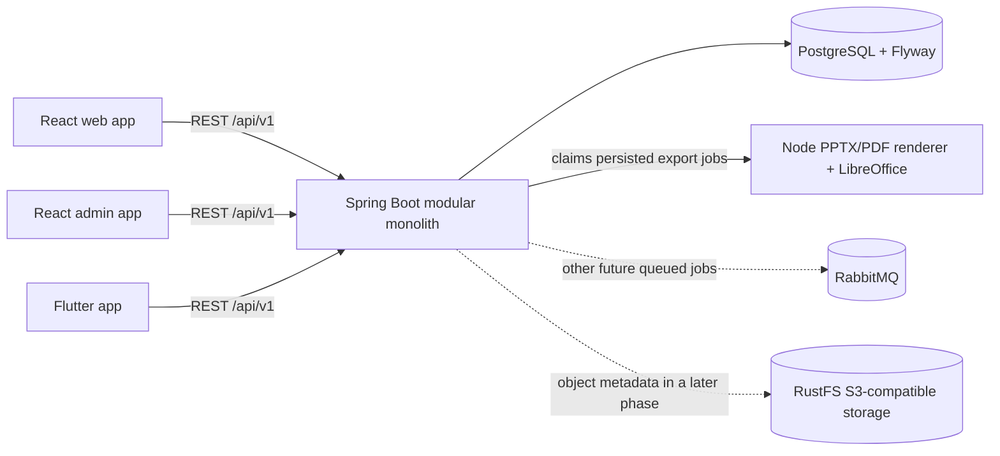

# Architecture

## Components

The backend is one deployable Spring Boot modular monolith. Packages are grouped by business capability; PostgreSQL is the source of truth. The canonical, versioned deck JSON is shared by the editor and renderer. The renderer is a separate Node package because `pptxgenjs` is the chosen editable PowerPoint writer and LibreOffice produces PDF from that output. Local object storage uses RustFS behind the S3 API; the current marketplace snapshots canonical JSON and does not upload binaries. The web client has the editor, exports, and AI generation flow; the Flutter client has authentication, library management, multi-slide text editing, and versioned saves. The admin client provides role-protected user management.

## Request and job flows

Clients call the versioned `/api/v1` API. Authentication, profile, and owner-scoped presentation routes are implemented; registration, login, refresh, verification, and password-action endpoints pass through a per-instance auth rate limiter. Production Caddy sets `X-Forwarded-For` to the connected client address, and Spring's forwarded-header strategy makes the API rate limiter use that address rather than the shared proxy address. The API is private behind Caddy; a multi-instance deployment needs a distributed rate limiter. Actuator exposes liveness/readiness health. Springdoc serves the OpenAPI UI in development and is disabled by production Compose. Flyway applies SQL migrations when the API starts against PostgreSQL.

Export flow: the authenticated API validates presentation ownership, pins the requested immutable version, and persists an export job in PostgreSQL. The scheduled worker claims queued jobs with `FOR UPDATE SKIP LOCKED`, sends canonical JSON to the private renderer service, and stores the generated artifact on the configured persistent export volume. Clients poll the owner-scoped API and download through an authenticated route. Stale running jobs are requeued after the configured timeout.

AI generation flow: an authenticated API request persists a bounded owner-scoped job in PostgreSQL. The API-process worker claims queued jobs and calls a server-configured OpenAI-compatible provider with a timeout. It validates and normalizes the returned deck against the canonical schema and output limits before persisting success; provider errors or invalid output fail explicitly. Clients poll the job and save a successful result as a presentation. RabbitMQ is not used by this current workflow.

## Security boundaries

The API, not a client, authorizes roles and presentation ownership. PostgreSQL stores metadata and canonical JSON, not uploaded binaries. AI provider credentials stay server-side. The status, health, auth, catalog, and API documentation routes are public as appropriate; protected business routes require bearer authentication. Admin and owner management routes enforce roles/ownership at the API boundary. Real payment-provider callbacks, asset uploads, and buyer entitlements are not production features until provider integration and storefront flows are complete.