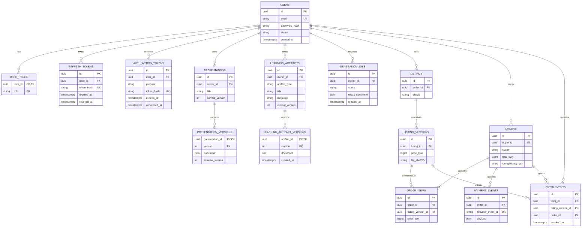

# Data model

UUIDs are primary keys, timestamps are `TIMESTAMPTZ`, and monetary values are integer tiyin plus ISO currency. Deck and learning-artifact versions hold immutable canonical JSON documents in JSONB. See the Flyway migrations for exact constraints and indexes.

Flyway migrations create users/roles/sessions/presentations, learning artifacts and immutable artifact versions (V13), work-credit wallets and their top-up/debit ledger (V14), hashed verification and password-recovery tokens, persisted presentation generation jobs, marketplace listing snapshots, idempotent orders, payment events, and entitlements. V8 conditionally bootstraps the first administrator from operator-provided email and BCrypt hash. Wallet top-ups are sandbox-only; real provider callbacks, uploaded assets, moderation, reviews, notifications, and immutable admin audit events remain future work.