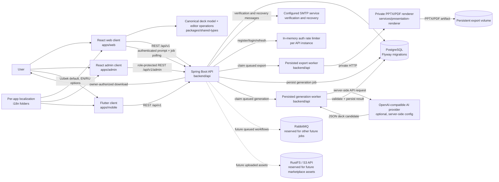
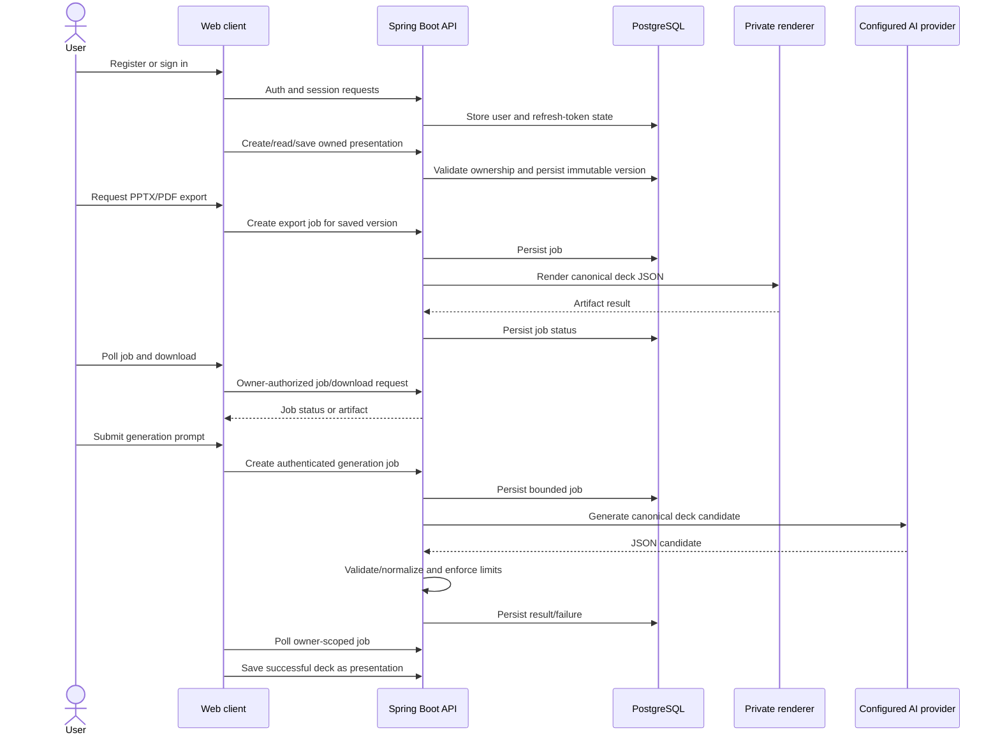

# Project map

This is a fast orientation map, not a replacement for the implementation or detailed docs. Last reviewed: 2026-11-16.

## System overview

Solid paths are documented as implemented; dashed paths are planned or reserved and should not be treated as working features without code verification.

## Main user flows

## Where to look

| Area | Location | Responsibility |
|---|---|---|
| Web app | `apps/web/` | Public landing page plus a separate `/marketplace` storefront, standalone sign-in and self-registration, authenticated presentation library, draggable editor, save/export UI, responsive marketplace publishing for owned presentations, and account wallet history |
| Localization | `apps/web/src/i18n/`, `apps/admin/src/i18n/`, `apps/mobile/lib/i18n/` | Per-app English, Russian, and Uzbek catalogs and locale preference helpers; new clients default to Uzbek with Ş/ş, Ç/ç, Ö/ö, and Ğ/ğ |
| Web landing and brand | `apps/web/src/features/landing/LandingPage.tsx`, `apps/web/src/features/landing/AppsShowcase.tsx`, `apps/web/src/features/landing/usePublicPageMotion.ts`, `apps/web/src/assets/slideforge-mark.svg` | Localized landing at `/`, centered in-page web/admin/mobile sections with illustrative previews, a desktop header for “What can you make?”, highlighted Marketplace, and “How it works”, plus a mobile logo-only header and Liquid Glass marketplace/sign-in/register bottom bar |
| Admin app | `apps/admin/` | Standalone staff sign-in and invitation-only registration, then role-protected user and marketplace management with responsive table layouts |
| Mobile app | `apps/mobile/` | Flutter sign-in, self-registration and email verification, library, create/open, multi-slide text/title editing, versioned saves and conflict reload |
| API | `backend/api/` | Auth, email actions, presentations, exports, generation, admin, marketplace |
| Auth rate limit | `backend/api/src/main/java/com/slideforge/api/common/AuthRateLimitFilter.java` | Per-instance fixed-window limits for register/login/refresh |
| Shared deck model | `packages/shared-types/` | Versioned deck types, operations, undo/redo |
| Renderer | `services/presentation-renderer/` | Editable PPTX generation and PDF conversion |
| Marketplace UI | `apps/web/src/features/marketplace/StorefrontPage.tsx`, `apps/web/src/features/marketplace/Marketplace.tsx` | Dedicated responsive storefront at `/marketplace` with catalog, cart, checkout, and publish dialog for owned canonical presentations; arbitrary-file upload is not implemented |
| Account billing UI | `apps/web/src/features/wallet/WalletPanel.tsx` | Wallet balance and transaction ledger; real card processing and legal invoices are not implemented |
| Web editor | `apps/web/src/features/presentations/PresentationEditor.tsx` | Pointer-drag and keyboard positioning for slide elements |
| Infrastructure | `docker-compose.yml`, `infra/deployment/`, `.github/workflows/deploy-production.yml` | Local development services plus Ubuntu 24.04 Compose/Caddy/GHCR deployment for `eduslides.encode.uz`, `admin-eduslides.encode.uz`, and `api-eduslides.encode.uz` (with `www` redirects), configured for `/home/encode/eduslides`; live VDS deployment is unverified |
| Roadmap / active status | `docs/ROADMAP.md`, `docs/CONTINUATION.md` | Phase status and next concrete work |
| API details | `docs/API.md` | HTTP contract |
| Data model | `docs/ERD.md` | Persisted entities and relationships |
| Local run/test steps | `docs/DEVELOPMENT.md` | Prerequisites, startup, validation commands |
| Production rollout | `docs/DEPLOYMENT.md` | VDS, GitHub secrets, deployment, smoke checks, backups |

For detailed security boundaries and design rationale, see `docs/SECURITY.md` and `docs/DECISIONS.md`.

## Phase orientation

The project has authentication, core presentation persistence, a web editor/export flow, validated AI generation jobs, admin user management, provider-independent marketplace/sandbox foundations, and a basic Flutter library/editor slice. See `docs/CONTINUATION.md` for the latest verified checkpoint and exact next work. Real payment adapters remain contract-gated, and a live VDS deployment remains unverified. The `docs/ROADMAP.md` table is authoritative for broader phase status.
