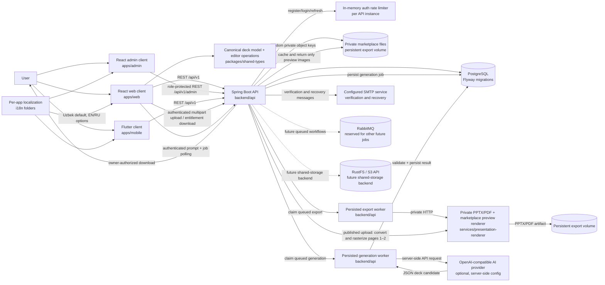
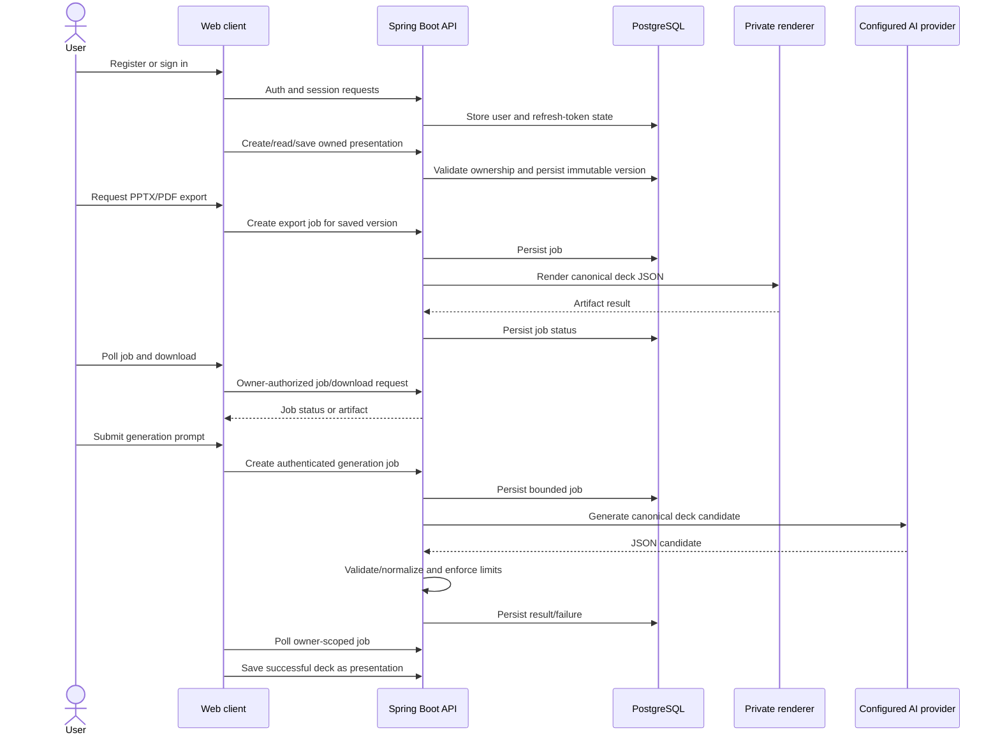
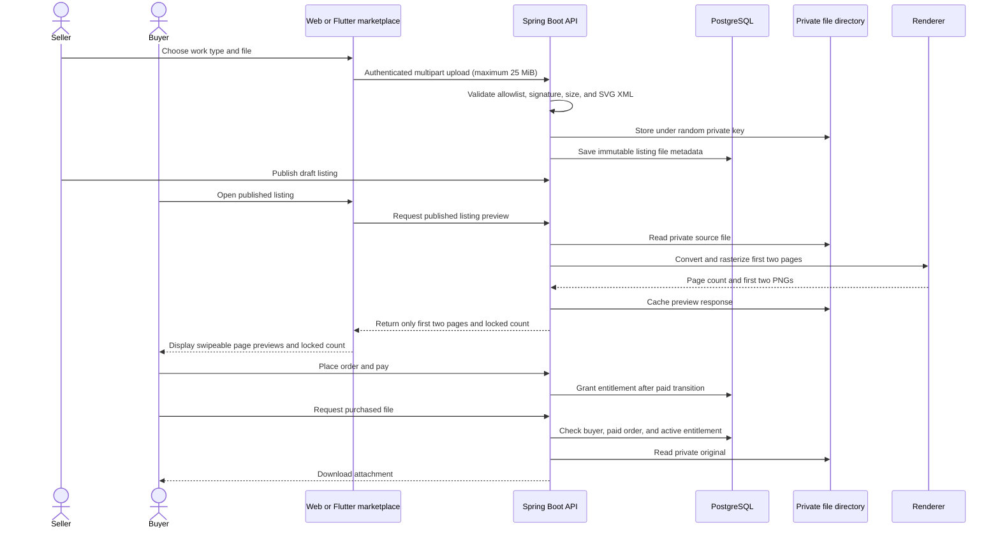

# Project map

This is a fast orientation map, not a replacement for the implementation or detailed docs. Last reviewed: 2026-11-18.

## System overview

Solid paths are documented as implemented; dashed paths are planned or reserved and should not be treated as working features without code verification.

## Main user flows

Uploaded-file previews expose only pages 1–2 as raster images. Original downloads are entitlement-gated and attachment-only. The API currently uses a persistent private filesystem directory; RustFS is not yet integrated, and automatic malware scanning/quarantine remains a release limitation.

## Where to look

| Area | Location | Responsibility |
|---|---|---|
| Web app | `apps/web/` | Public landing page plus a separate `/marketplace` storefront, standalone sign-in and self-registration, authenticated presentation library, draggable editor, save/export UI, responsive marketplace publishing for owned presentations and typed work files, and account wallet history |
| Localization | `apps/web/src/i18n/`, `apps/admin/src/i18n/`, `apps/mobile/lib/i18n/` | Per-app English, Russian, and Uzbek catalogs and locale preference helpers; new clients default to Uzbek with Ş/ş, Ç/ç, Ö/ö, and Ğ/ğ |
| Web landing and brand | `apps/web/src/features/landing/LandingPage.tsx`, `apps/web/src/features/landing/AppsShowcase.tsx`, `apps/web/src/features/landing/usePublicPageMotion.ts`, `apps/web/src/assets/slideforge-mark.svg` | EDU Slides-branded localized landing at `/`, centered in-page web/admin/mobile sections with illustrative previews, a desktop header for “What can you make?”, highlighted Marketplace, and “How it works”, plus a mobile logo-only header and Liquid Glass marketplace/sign-in/register bottom bar |
| Admin app | `apps/admin/` | EDU Slides logo and title on standalone staff sign-in/invitation registration and role-protected user and marketplace management screens; responsive table layouts |
| Mobile app | `apps/mobile/` | EDU Slides logo, native launcher icon, and title; sign-in, self-registration/email verification, library, create/open, multi-slide editing/versioned saves; marketplace catalog/cart, file upload/publish, first-two-page previews, and account wallet sandbox top-ups with withdrawals explicitly unavailable |
| API | `backend/api/` | Auth, email actions, presentations, exports, generation, admin, marketplace |
| Auth rate limit | `backend/api/src/main/java/com/slideforge/api/common/AuthRateLimitFilter.java` | Per-instance fixed-window limits for register/login/refresh |
| Shared deck model | `packages/shared-types/` | Versioned deck types, operations, undo/redo |
| Renderer | `services/presentation-renderer/` | Editable PPTX generation, PDF conversion, and first-two-page marketplace previews |
| Marketplace UI | `apps/web/src/features/marketplace/StorefrontPage.tsx`, `apps/web/src/features/marketplace/Marketplace.tsx` | Dedicated responsive storefront at `/marketplace` with catalog, cart, checkout, typed upload/publish flow, and purchase downloads |
| Mobile marketplace | `apps/mobile/lib/marketplace/marketplace_screen.dart`, `marketplace_upload_listing_dialog.dart`, `marketplace_file_preview_gallery.dart` | Authenticated typed work-file upload/publish and swipeable, zoomable first-two-page previews |
| Marketplace file API | `backend/api/src/main/java/com/slideforge/api/marketplace/MarketplaceFileStorage.java`, `MarketplaceService.java`, `MarketplaceFilePreviewService.java`, `CatalogController.java`, `PurchaseController.java` | Server-side allowlist/signature checks, private persistent source and preview-cache storage, public first-two-page previews, immutable listing metadata, and buyer-entitlement-gated original downloads |
| Account billing UI | `apps/web/src/features/wallet/WalletPanel.tsx`, `apps/mobile/lib/presentations/presentation_library_screen.dart` | Wallet balance and transaction history; mobile sandbox top-ups refresh the balance independently of transaction-history loading. Real card processing, cash withdrawals, seller payouts, and legal invoices are not implemented |
| Web editor | `apps/web/src/features/presentations/PresentationEditor.tsx` | Full-height responsive editor contained in the workspace main panel, with slide rail, canvas, tool inspector, inline text editing, drag-and-drop tools/images, theme and typography controls, undo/redo, save, and export |
| Infrastructure | `docker-compose.yml`, `infra/deployment/`, `.github/workflows/deploy-production.yml` | Local development services plus Ubuntu 24.04 Compose/Caddy/GHCR deployment for `eduslides.encode.uz`, `admin-eduslides.encode.uz`, and `api-eduslides.encode.uz` (with `www` redirects), configured for `/home/encode/eduslides`; live VDS deployment is unverified |
| Roadmap / active status | `docs/ROADMAP.md`, `docs/CONTINUATION.md` | Phase status and next concrete work |
| API details | `docs/API.md` | HTTP contract |
| Data model | `docs/ERD.md` | Persisted entities and relationships |
| Local run/test steps | `docs/DEVELOPMENT.md` | Prerequisites, startup, validation commands |
| Production rollout | `docs/DEPLOYMENT.md` | VDS, GitHub secrets, deployment, smoke checks, backups |

For detailed security boundaries and design rationale, see `docs/SECURITY.md` and `docs/DECISIONS.md`.

## Phase orientation

The project has authentication, core presentation persistence, a web editor/export flow, validated AI generation jobs, admin user management, provider-independent marketplace/sandbox foundations, and a basic Flutter library/editor slice. See `docs/CONTINUATION.md` for the latest verified checkpoint and exact next work. Real payment adapters remain contract-gated, and a live VDS deployment remains unverified. The `docs/ROADMAP.md` table is authoritative for broader phase status.
