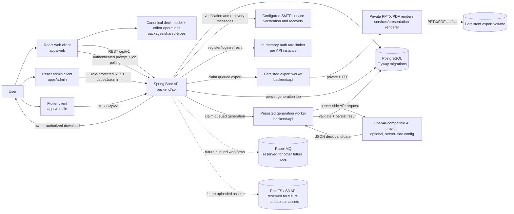
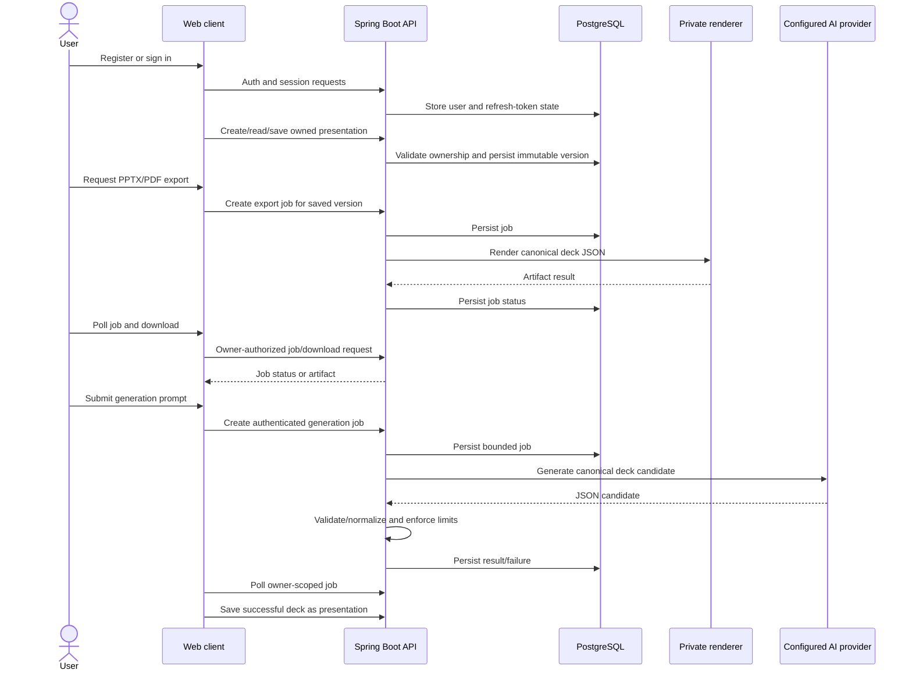

# Project map

This is a fast orientation map, not a replacement for the implementation or detailed docs. Last reviewed: 2026-11-09.

## System overview

Solid paths are documented as implemented; dashed paths are planned or reserved and should not be treated as working features without code verification.

## Main user flows

## Where to look

| Area | Location | Responsibility |
|---|---|---|
| Web app | `apps/web/` | Authenticated presentation library, editor, save/export UI |
| Admin app | `apps/admin/` | Staff sign-in and role-protected user management |
| Mobile app | `apps/mobile/` | Flutter auth, library, create/open, multi-slide text/title editing, versioned saves and conflict reload |
| API | `backend/api/` | Auth, email actions, presentations, exports, generation, admin, marketplace |
| Auth rate limit | `backend/api/src/main/java/com/slideforge/api/common/AuthRateLimitFilter.java` | Per-instance fixed-window limits for register/login/refresh |
| Shared deck model | `packages/shared-types/` | Versioned deck types, operations, undo/redo |
| Renderer | `services/presentation-renderer/` | Editable PPTX generation and PDF conversion |
| Infrastructure | `docker-compose.yml`, `infra/` | Local development services and deployment configuration |
| Roadmap / active status | `docs/ROADMAP.md`, `docs/CONTINUATION.md` | Phase status and next concrete work |
| API details | `docs/API.md` | HTTP contract |
| Data model | `docs/ERD.md` | Persisted entities and relationships |
| Local run/test steps | `docs/DEVELOPMENT.md` | Prerequisites, startup, validation commands |
| Production rollout | `docs/DEPLOYMENT.md` | VDS, GitHub secrets, deployment, smoke checks, backups |

For detailed security boundaries and design rationale, see `docs/SECURITY.md` and `docs/DECISIONS.md`.

## Phase orientation

The project has authentication, core presentation persistence, a web editor/export flow, validated AI generation jobs, admin user management, provider-independent marketplace/sandbox foundations, and a basic Flutter library/editor slice. See `docs/CONTINUATION.md` for the latest verified checkpoint and exact next work. Real payment adapters remain contract-gated, and a live VDS deployment remains unverified. The `docs/ROADMAP.md` table is authoritative for broader phase status.
